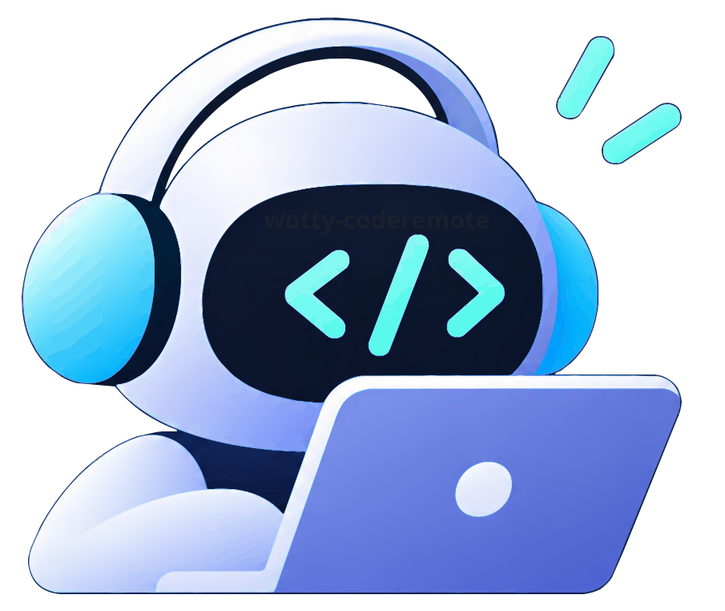

# Code Remote (Remote Development Workbench)

<p align="center"></p>

<p align="center">
  <a href="CHANGELOG.md"></a>
  <a href="https://github.com/wottyup/code-remote/stargazers"></a>
  <a href="https://github.com/wottyup/code-remote/forks"></a>
  <a href="https://github.com/wottyup/code-remote/issues"></a>
  <a href="https://github.com/wottyup/code-remote/commits/main"></a>
</p>
<p align="center">
  <a href="android/app/build.gradle"></a>
  <a href="package.json"></a>
  <a href="package.json"></a>
  <a href="server/requirements.txt"></a>
  <a href="android/build.gradle"></a>
</p>

Remotely view and control Codex and Claude Code running on your development computer from a mobile browser or native Android app. Supports session history, real-time message exchange, model selection, attachments, workspace files, and a terminal; the coding assistants run on the development computer.

## Prerequisites

- Codex CLI installed and logged in, invoked as `codex`
- Node.js 20.19+ and pnpm
- Python 3.10+
- Phone and computer on the same trusted LAN

## First-time Setup

Create a Python virtual environment in the project directory and install the server dependencies:

```bash
cd /code/code-remote
python3 -m venv .venv
. .venv/bin/activate
pip install -r server/requirements.txt
```

Frontend dependencies are managed by `/code/pnpm-workspace.yaml`. After running `pnpm install` once from the workspace root, use the start command below.

## Starting

For day-to-day remote use, run the following in a terminal on your computer: it builds the web frontend, then starts both the local Codex engine and the LAN page.

```bash
cd /code
pnpm --filter code-remote start
```

The built assets support compression and caching, which is good for long sessions on a phone. Only use `pnpm --filter code-remote dev` when editing the frontend and you want hot reload; the dev server loads heavier debug assets.

When startup finishes, the terminal prints a pairing code needed to authorize a new browser. Open `http://<computer's LAN IP>:4173` on the phone. After pairing succeeds, that browser is recorded as a trusted device: you won't need to enter the code again even if the local service restarts; only a new browser, an incognito window, or clearing site data requires re-pairing. You can also visit `http://127.0.0.1:4173` locally on the computer.

The web version connects only to the Code Remote service at the URL currently open. To access another computer, just open that computer's web address and pair separately.

To keep it running in the background, install the systemd units from the repo:

```bash
sudo install -m 0644 /code/code-remote/deploy/code-remote.service /etc/systemd/system/code-remote.service
sudo install -m 0644 /code/code-remote/deploy/code-remote-tmux.service /etc/systemd/system/code-remote-tmux.service
sudo systemctl daemon-reload
sudo systemctl enable --now code-remote-tmux.service code-remote.service
```

These units build the web frontend at startup and serve the built assets. After updating an installed unit, run `systemctl daemon-reload`; an already-running service must be restarted after its chat tasks finish to load the new backend. The service also manages Codex child processes, so restarting interrupts any tasks still in progress.

View the resident service's pairing code and logs with:

```bash
journalctl -u code-remote.service -f
```

The web service forwards API and WebSocket requests to `127.0.0.1:18766` on the computer. The Codex App Server is reached only via local stdio; it opens no network port. The web connection between phone and computer uses LAN HTTP; use it only on trusted networks and allow the computer's firewall to accept connections on port 4173.

Both Windows and Linux are supported. On native Windows, create `.venv` in a PowerShell session in the project directory, then run `pnpm --filter code-remote start`, or double-click `start-code-remote.bat`; the launcher automatically uses `.venv\Scripts\python.exe` and supports `codex.cmd`/`codex.exe`. If Codex is not on PATH, set it explicitly:

```powershell
$env:CODE_REMOTE_COMMAND = "C:\Users\<your username>\AppData\Roaming\npm\codex.cmd"
$env:CODE_REMOTE_WORKSPACE = "C:\path\to\your\project"
pnpm --filter code-remote start
```

On Linux/macOS the chat terminal keeps sessions alive with tmux; on Linux run `sudo apt-get install tmux`, on macOS run `brew install tmux`. When using systemd, also install `code-remote-tmux.service` above so the tmux shell can reconnect after the Python service restarts. Sessions are cleaned up after a computer reboot, when the tmux service is stopped manually, when you type `exit`, when a session is idle for 30 minutes, or when there are more than 10 unattached sessions. Native Windows terminals keep temporary-shell behavior.

## SSH MCP Remote Servers

In the web UI, go to Settings → SSH MCP Servers and enter the server IP or hostname, port, username, and password; you can add multiple hosts. SSH passwords are stored on the computer running Code Remote, and the settings page never echoes saved passwords. After saving, new or reopened Codex conversations use the latest settings; running conversations are unaffected. SSH MCP currently connects only to Codex; Claude Code's command approval cannot yet be forwarded to the web UI.

The backend must be installed on the same host as the Codex it drives; a Linux backend cannot directly see a Codex process on a separate Windows host.

Trusted-device token digests are stored in the user data directory; raw tokens and pairing codes are never written to that file. Windows defaults to `%LOCALAPPDATA%\CodexRemote`, keeping app data out of the project or restricted Codex run directories; Linux/macOS default to `~/.codex/codex-remote`. Signing out in the web UI revokes the current device; if a device is lost, stop the service, delete the authorization files in that directory, and start it again to re-pair all devices. Locations can be overridden with `CODE_REMOTE_HOME` or `CODE_REMOTE_AUTH_FILE`.

## Working Directory and Session History

New conversations default to the directory above the app repo as the working directory (for example, if the app lives at `/code/code-remote`, the default working directory is `/code`), so newly cloned projects sit alongside `code-remote` rather than inside the app repo. You can override this with an environment variable or a start argument:

```bash
CODE_REMOTE_WORKSPACE=/path/to/your/project pnpm --filter code-remote engine:dev
```

The history list reads the 100 most recent non-archived Codex sessions on the machine, including ones created in other working directories; after opening a session, its working directory is shown below the title. The backend watches the Codex session files and pushes updates to the sidebar over WebSocket, so no page refresh is needed.

The local Codex App Server uses the user-level `CODEX_HOME` directly by default, so the web UI and desktop Codex read and write the same configuration, models, and session history. Like Hapi, on Windows it prefers the Codex CLI actually resolved from PATH and starts the app-server directly, connecting through a random port that listens only on `127.0.0.1` plus a capability token; it no longer depends on a shared daemon/control socket requiring extra privileges. A code-installed Codex resolves from the `.cmd` shim to the `codex.js` in the same installation and is started by Node. Conversations created or resumed in the web UI are written to the user's existing history by the Codex app-server. You can set `CODE_REMOTE_APP_SERVER_HOME` explicitly to pin a separate data directory.

## Handing Sessions Back and Forth Between the Web UI and Local Codex

A session to which the web UI has sent messages is held for writing by the web-specific App Server. To continue that session in the local Codex, first wait for the web reply to finish, then click "Return to machine" at the top-right of the chat page and confirm. This only closes the web-specific Codex child process; it does not restart the dev service, SSH sessions, or browser pairing, and the web UI will not automatically reclaim the session.

To continue in the web UI again, make sure the local Codex has finished the session's tasks, then click "Take over" at the top-right. If the machine still holds the session, the web UI clearly warns that the session is being used by another Codex instance.

## Building

```bash
cd /code
pnpm --filter code-remote build
```

Build output goes to `code-remote/dist`. `pnpm start` builds automatically and serves the page via Vite preview, with `scripts/dev.mjs --production` starting the Python engine at the same time; under systemd, `code-remote.service` manages it continuously in the background.
